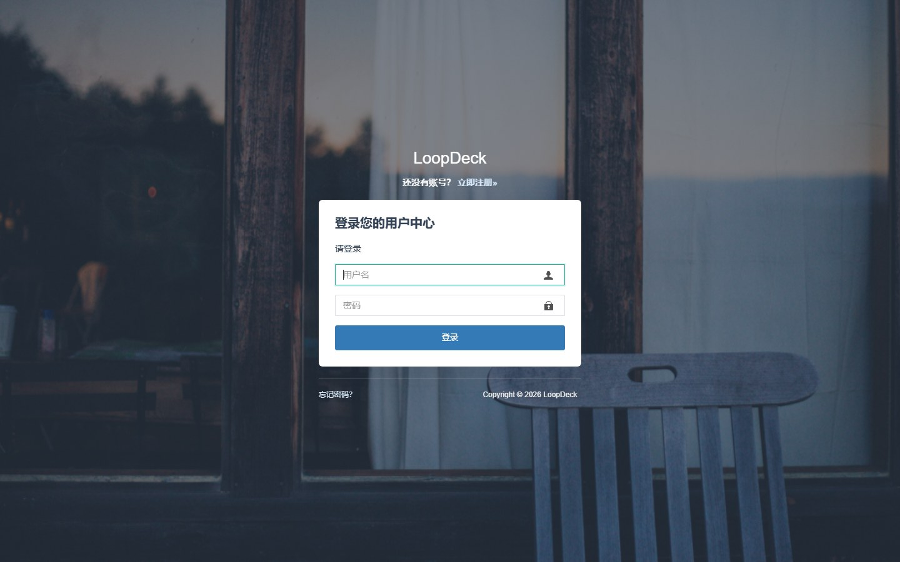
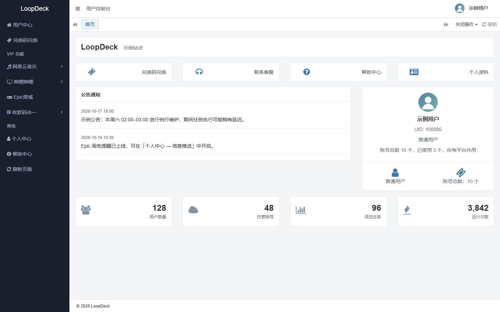
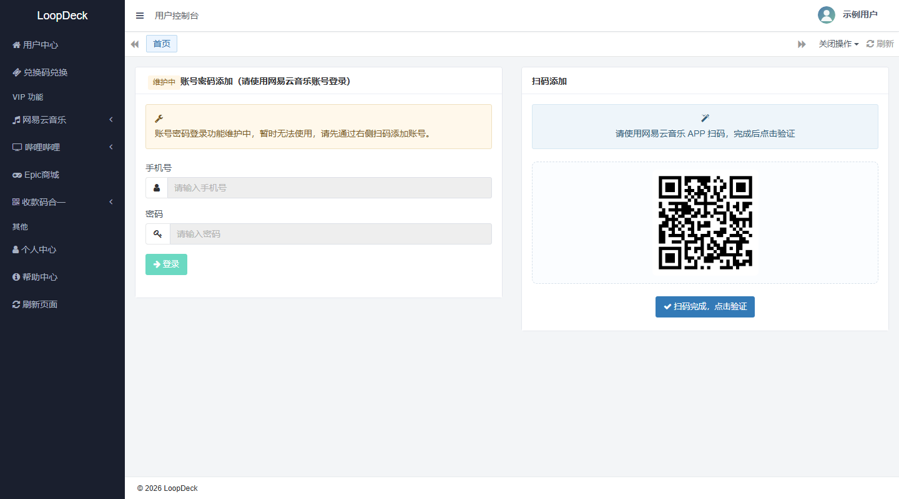
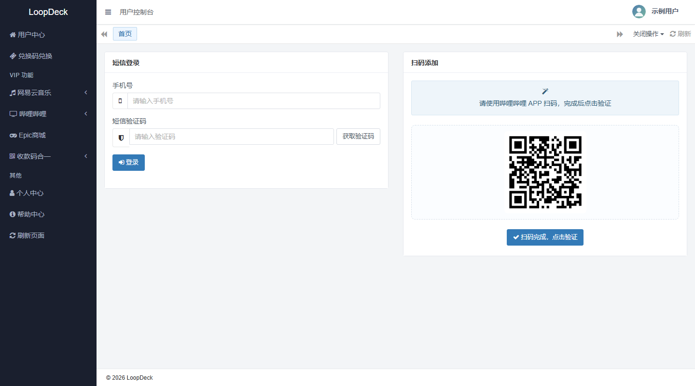
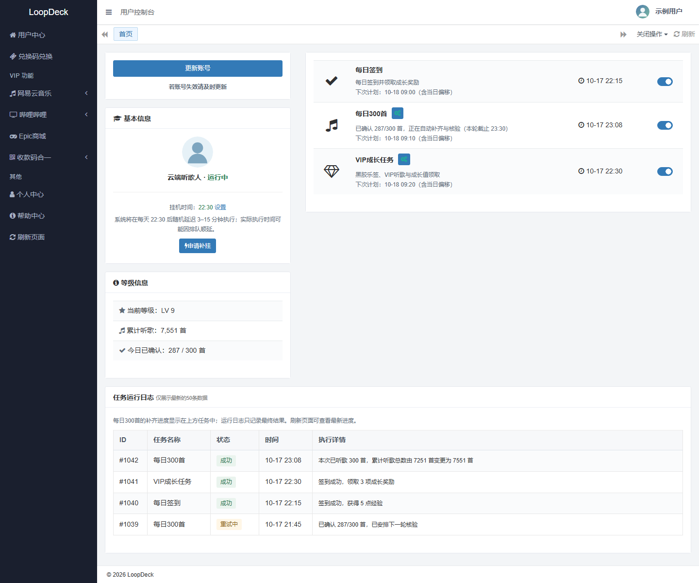
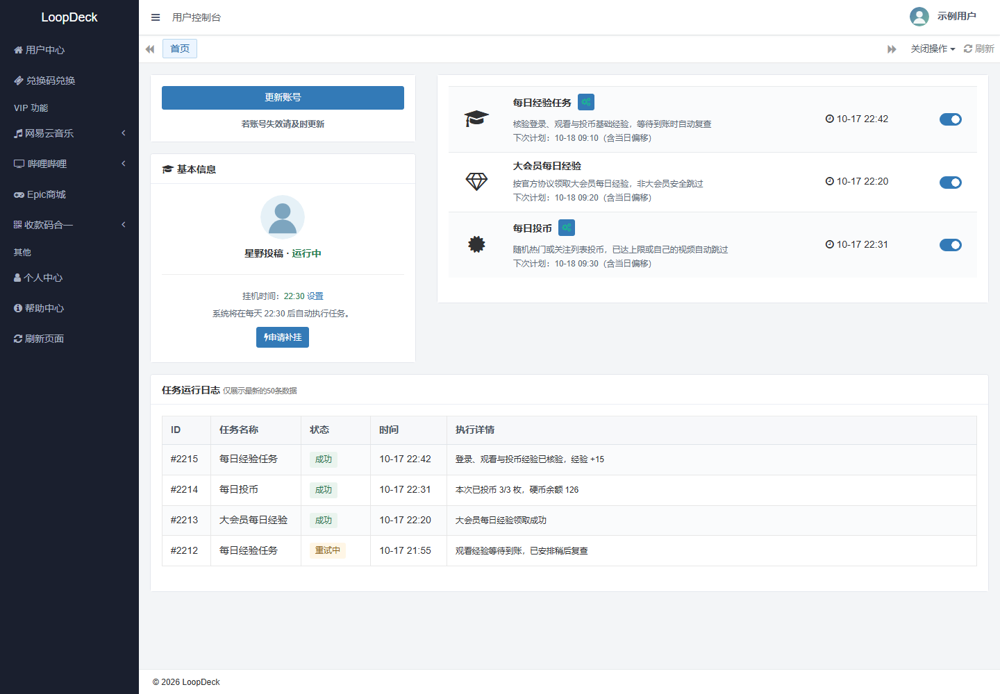
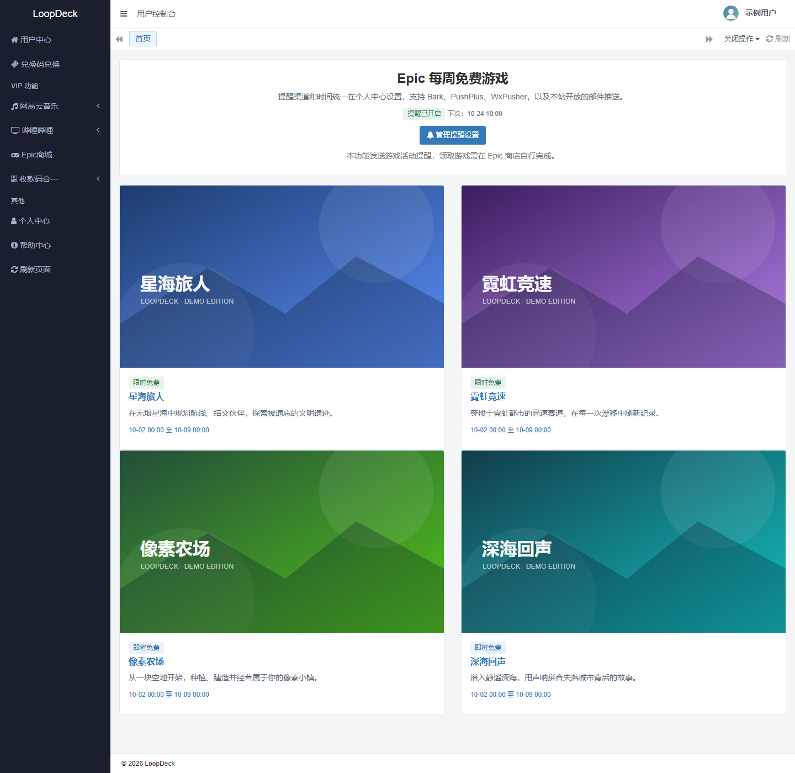
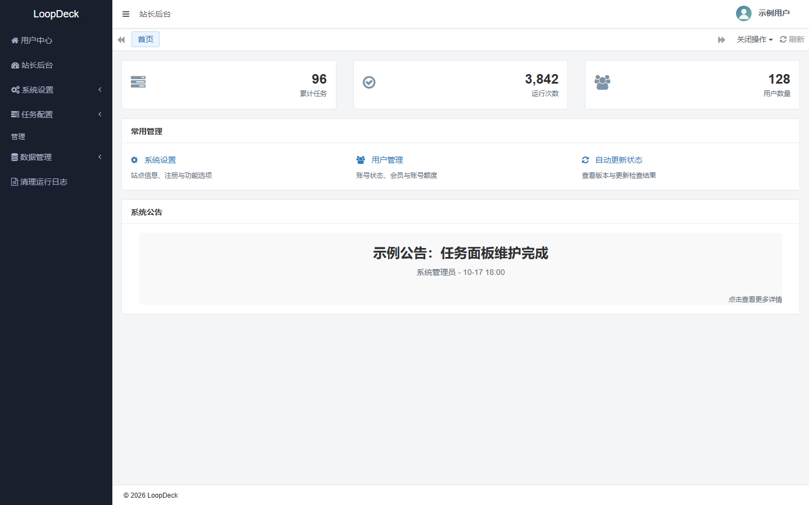
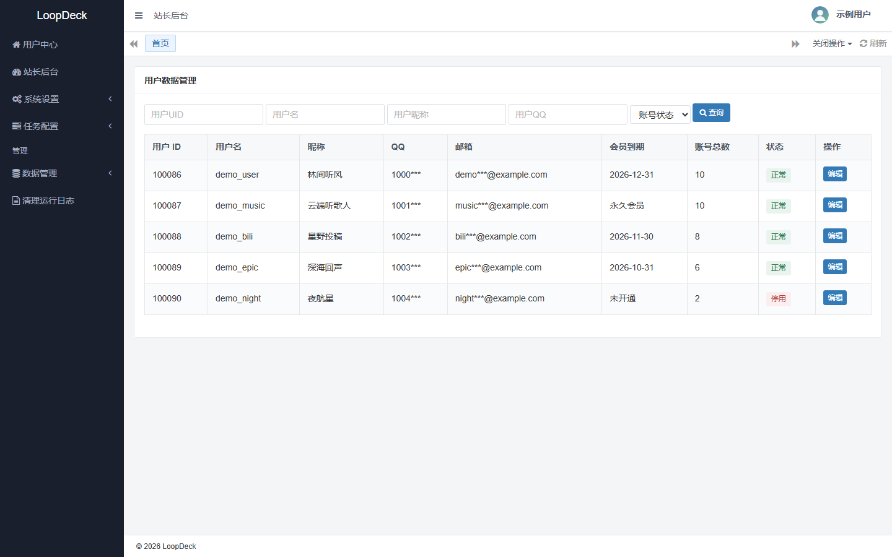

<div align="center">
  <a href="https://github.com/7788dev/loopdeck">
    
  </a>

  <h1>LoopDeck</h1>

  <p><strong>清爽、可自托管的多平台云任务面板</strong><br>
  网易云音乐 · 哔哩哔哩 · Epic 周免 · 多通道通知</p>

  <p>
    
    
    
    
    
  </p>

  <p>
    <a href="#快速开始">快速开始</a> ·
    <a href="#界面预览">界面预览</a> ·
    <a href="docs/DEPLOYMENT.md">部署指南</a> ·
    <a href="DOCKER.md">Docker 运维</a> ·
    <a href="docs/CHANGELOG.md">更新日志</a>
  </p>
</div>

> [!IMPORTANT]
> 本项目仅用于个人学习、技术研究与交流，禁止用于任何违法或侵权用途。项目与网易云音乐、哔哩哔哩、Epic Games 等第三方平台无关联，也不对使用后果承担责任。请先阅读 [免责声明](DISCLAIMER.md)。

## 界面预览

> 截图使用本地脱敏示例数据渲染，昵称、账号、邮箱与 QQ 均为演示值；二维码为演示图片，无法实际登录。点击图片可查看 1440px 桌面原图。

<table>
  <tr>
    <td width="50%"><a href="docs/screenshots/login.jpg"></a></td>
    <td width="50%"><a href="docs/screenshots/console.png"></a></td>
  </tr>
  <tr>
    <td align="center"><sub>登录 · 简洁的入口与错误反馈</sub></td>
    <td align="center"><sub>用户控制台 · 快捷入口、公告与运行概览</sub></td>
  </tr>
  <tr>
    <td width="50%"><a href="docs/screenshots/netease-qr.png"></a></td>
    <td width="50%"><a href="docs/screenshots/bilibili-qr.png"></a></td>
  </tr>
  <tr>
    <td align="center"><sub>网易云音乐 · 扫码绑定账号</sub></td>
    <td align="center"><sub>哔哩哔哩 · 扫码或短信绑定</sub></td>
  </tr>
  <tr>
    <td width="50%"><a href="docs/screenshots/netease-manage.png"></a></td>
    <td width="50%"><a href="docs/screenshots/bilibili-manage.png"></a></td>
  </tr>
  <tr>
    <td align="center"><sub>网易云音乐 · 任务进度、等级与运行日志</sub></td>
    <td align="center"><sub>哔哩哔哩 · 任务开关与运行日志</sub></td>
  </tr>
  <tr>
    <td width="50%"><a href="docs/screenshots/epic.png"></a></td>
    <td width="50%"><a href="docs/screenshots/admin.png"></a></td>
  </tr>
  <tr>
    <td align="center"><sub>Epic 每周免费游戏 · 提醒与活动列表</sub></td>
    <td align="center"><sub>站长后台 · 运行概览与常用管理</sub></td>
  </tr>
  <tr>
    <td colspan="2"><a href="docs/screenshots/admin-users.png"></a></td>
  </tr>
  <tr>
    <td colspan="2" align="center"><sub>用户数据管理 · 配额、会员与账号状态（示例数据）</sub></td>
  </tr>
</table>

## 功能概览

| 模块 | 能力 |
| --- | --- |
| 网易云音乐 | 每日签到、VIP 成长、每日 300 首听歌、音乐人/合伙人任务；支持历史去重、限时核验与失败原因展示 |
| 哔哩哔哩 | 扫码或短信绑定账号，六项日常任务与经验/硬币奖励核验，按任务独立启停 |
| Epic 商城 | 每周免费游戏提醒，按个人偏好通过通知渠道送达 |
| 账号与日志 | 多账号管理、任务进度、状态开关、运行日志与失败重试 |
| 通知中心 | Bark、PushPlus、WxPusher 与 SMTP 邮件；每日任务总览可独立开启 |
| 权益管理 | 管理员设置、注册赠送与兑换码分配会员时长/账号总额度；无在线支付与余额 |
| 部署运维 | Docker Compose、内置 MySQL、健康检查、镜像自动更新与单站点配置 |

详细的任务协议与高级参数见 [功能与高级说明](docs/FEATURES.md)。

## 快速开始

### Docker（推荐）

需要 Docker Compose **2.20.0+**。

```bash
git clone https://github.com/7788dev/loopdeck.git
cd loopdeck
sh docker/deploy.sh
```

脚本会自动准备配置、数据库凭据和调度密钥。首次访问 `http://<服务器>:8001` 进入安装页，只需设置管理员账号；数据库连接无需手动填写。

已有部署升级时保留原目录、`.env` 与数据卷，使用原 Compose 项目名操作。详见 [部署指南](docs/DEPLOYMENT.md) 与 [Docker 部署文档](DOCKER.md)。

### 本地开发

```bash
composer install
cp config/Db.example.php config/Db.php   # 填入本地 MySQL
php think run
```

### 测试

```bash
for test_file in tests/*Test.php; do php "$test_file"; done
node tests/FrontendInteractionTest.js
```

功能测试使用隔离的内存数据库；Windows 下的 PHP 需要启用 `pdo_sqlite`。

<details>
<summary><strong>让 AI Agent 帮你部署</strong></summary>

将下面这段提示词交给 Claude Code、Codex 或其他能执行终端命令的 Agent：

```text
请帮我部署 LoopDeck，项目地址：https://github.com/7788dev/loopdeck。

先阅读 AGENTS.md、docs/DEPLOYMENT.md 和 DOCKER.md，再检查服务器系统、Docker Compose 版本、内存、端口与已有容器。需要 Docker Compose 2.20.0+。默认使用项目自带 MySQL，在项目目录运行 sh docker/deploy.sh，不要手写数据库密码或先手工建库。首次访问完成安装页，只创建管理员账号。保留已有 .env、数据卷和其他服务；不要通过删除数据卷解决问题，也不要在报告中暴露密钥。最后报告访问地址、版本、安装状态，以及日志、重启、备份和更新的方式。
```

</details>

## 文档

| 文档 | 内容 |
| --- | --- |
| [部署指南](docs/DEPLOYMENT.md) | 首次安装、外部 MySQL、升级与备份 |
| [Docker 部署与运维](DOCKER.md) | Compose 服务、环境变量、更新器与网络 |
| [功能与高级说明](docs/FEATURES.md) | 任务协议、听歌核验、配额与兑换说明 |
| [更新日志](docs/CHANGELOG.md) | 版本记录与历史变更 |
| [系统分析与修复报告](docs/SYSTEM-ANALYSIS-2026-10-13.md) | 安全、并发与数据库修复记录 |
| [免责声明](DISCLAIMER.md) · [MIT License](LICENSE) | 使用边界与非关联声明 |

## 项目结构

```text
app/        index 用户端、admin 管理端、cron 调度、install 安装器与共享服务
extend/     各平台适配器（Composer classmap 加载）
config/     应用、数据库、视图与中间件配置
public/     入口文件、静态资源与上传目录
docker/     Compose、镜像与更新器脚本
tests/      离线回归、数据库集成与前端交互测试
docs/       部署、功能与版本文档
```

## 版本

当前发布：**v1.2.37**。`main` 已合入网易云任务登录失效检测修复，完整记录见 [更新日志](docs/CHANGELOG.md)。

- 依据生产真实上游形态识别 cookie 过期：等级接口匿名模板、账号接口空 `account`、VIP 子接口 301；
- 失效账号立即标记并提示「登录已失效，请重新扫码登录」，不再每日重复泛化失败；
- `login_work` 不再对失效会话误报「登录成功」，传输失败也不会误判健康账号失效；
- 云贝、合伙人、音乐人任务的 301/401 统一映射到账号失效流程。

## 免责声明

- 本项目仅用于个人学习、技术研究与交流，不构成对任何第三方平台服务的替代或绕过方案。
- 项目以社区协作方式维护，不代表任何个人或组织，与网易云音乐、哔哩哔哩、Epic Games 等平台无任何隶属、合作、授权或背书关系。
- 请遵守所在地法律法规及平台服务条款；禁止批量注册、账号交易、恶意刷量或其他损害平台和他人利益的行为。
- 使用者自行承担全部风险；作者与贡献者不对账号限制、数据丢失、服务中断或任何直接/间接损失负责。

完整条款见 [DISCLAIMER.md](DISCLAIMER.md)。

## 许可证

本项目以 [MIT License](LICENSE) 开源，版权归 LoopDeck contributors 所有。第三方平台名称与商标归其各自权利人所有。
