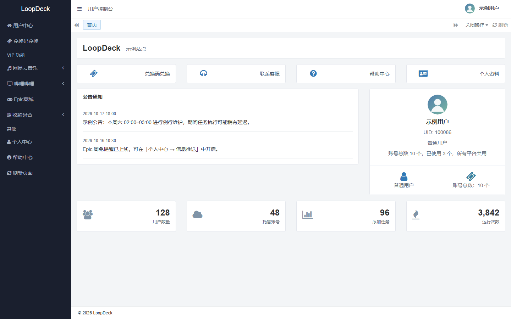
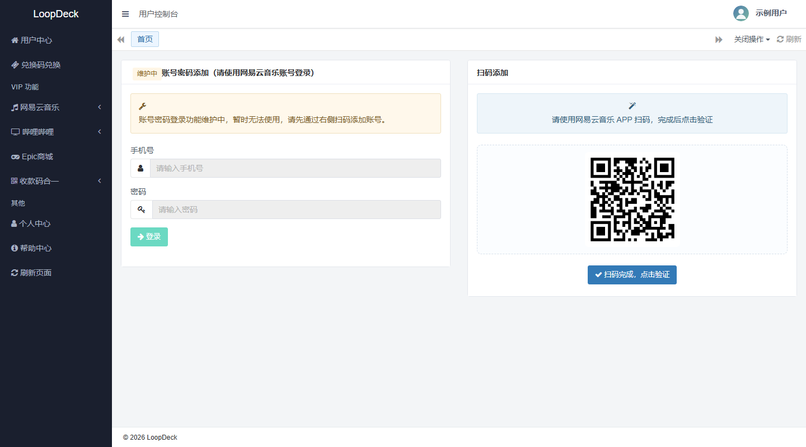
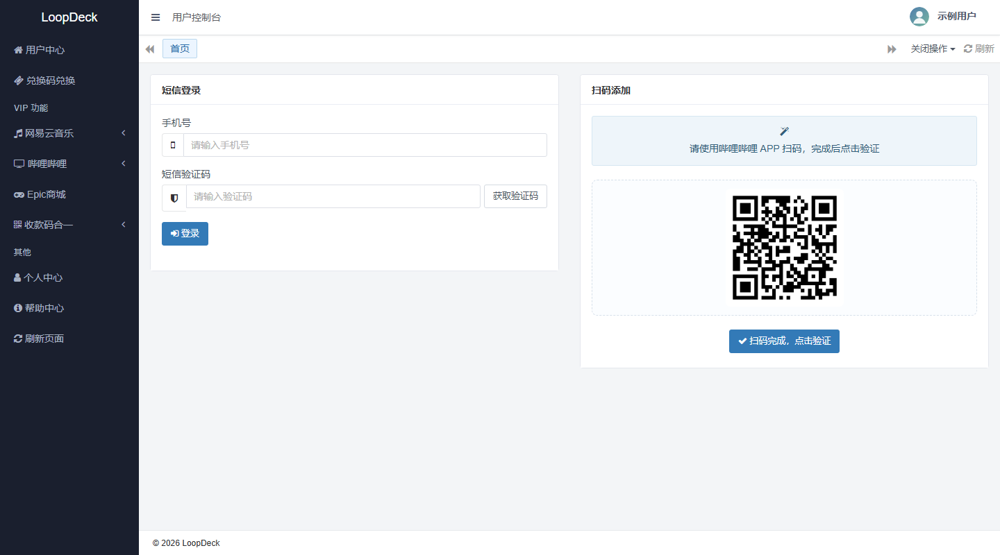
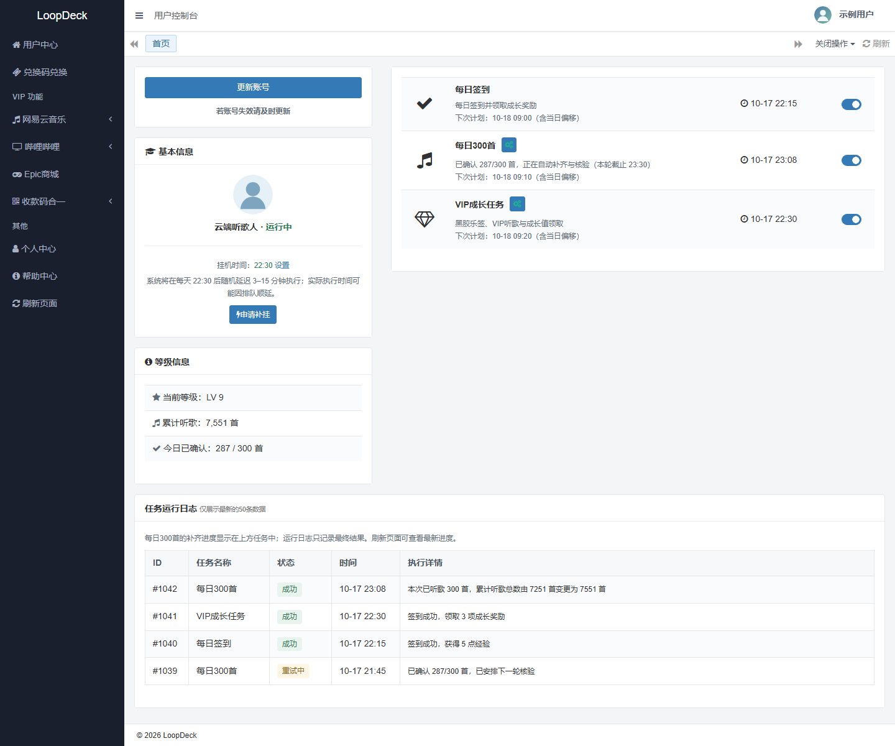
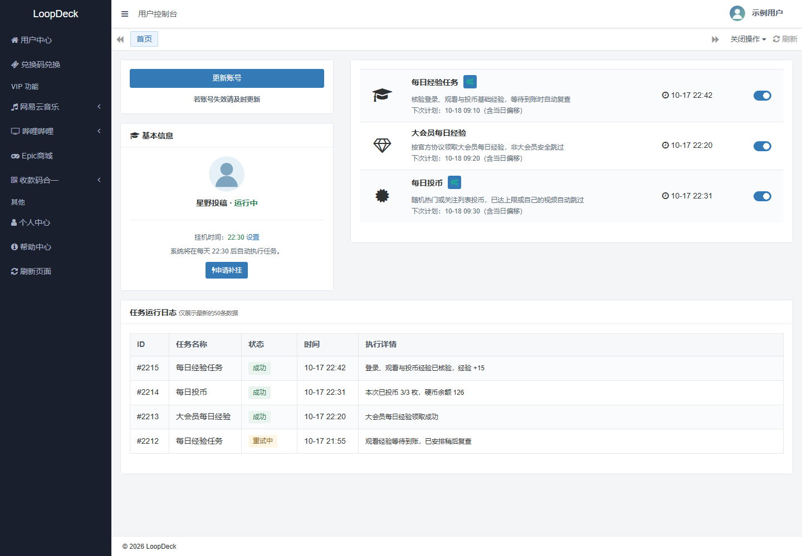
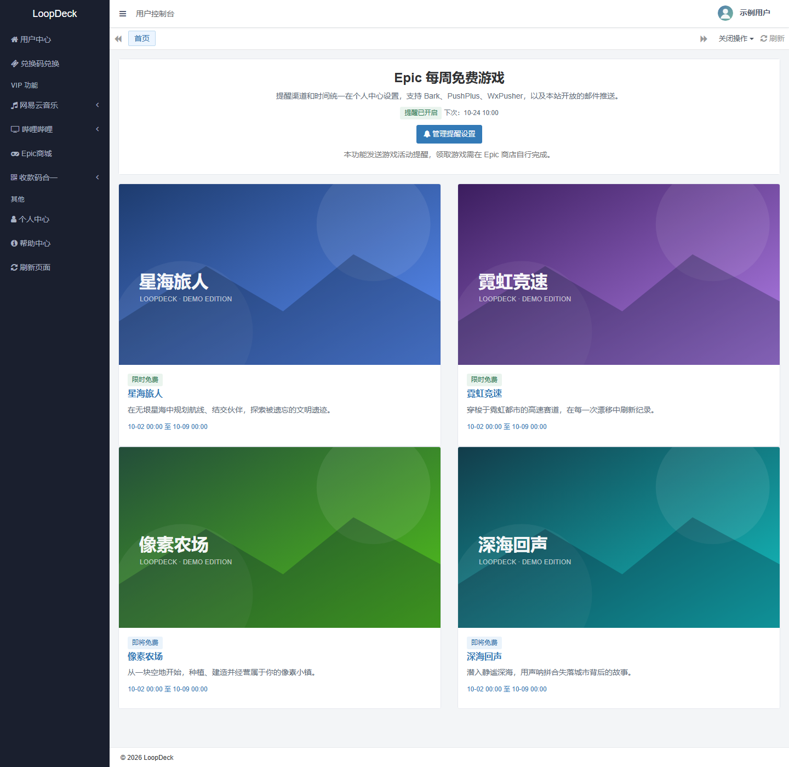
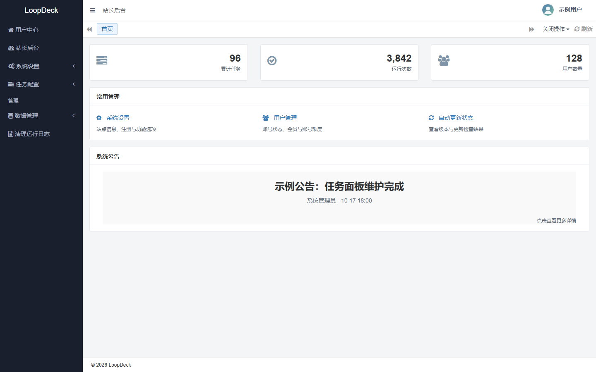
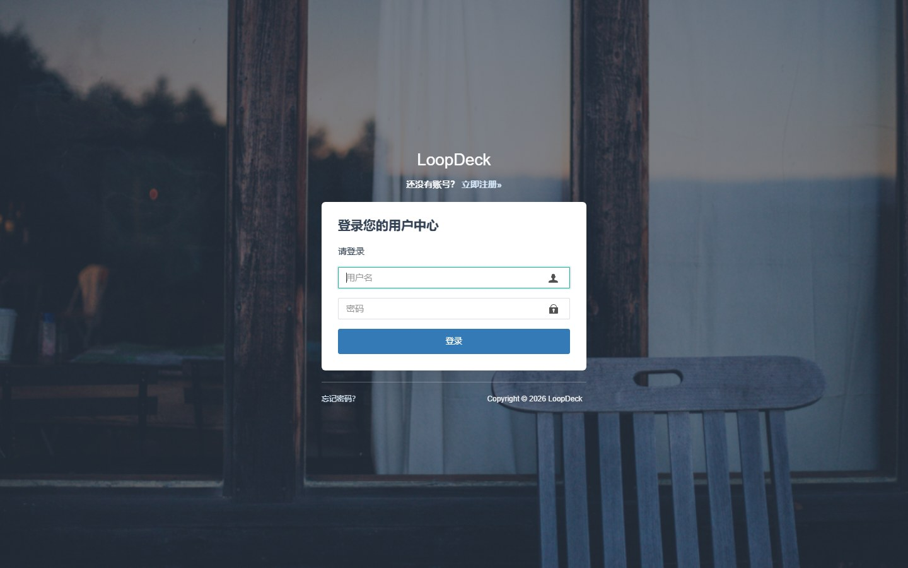
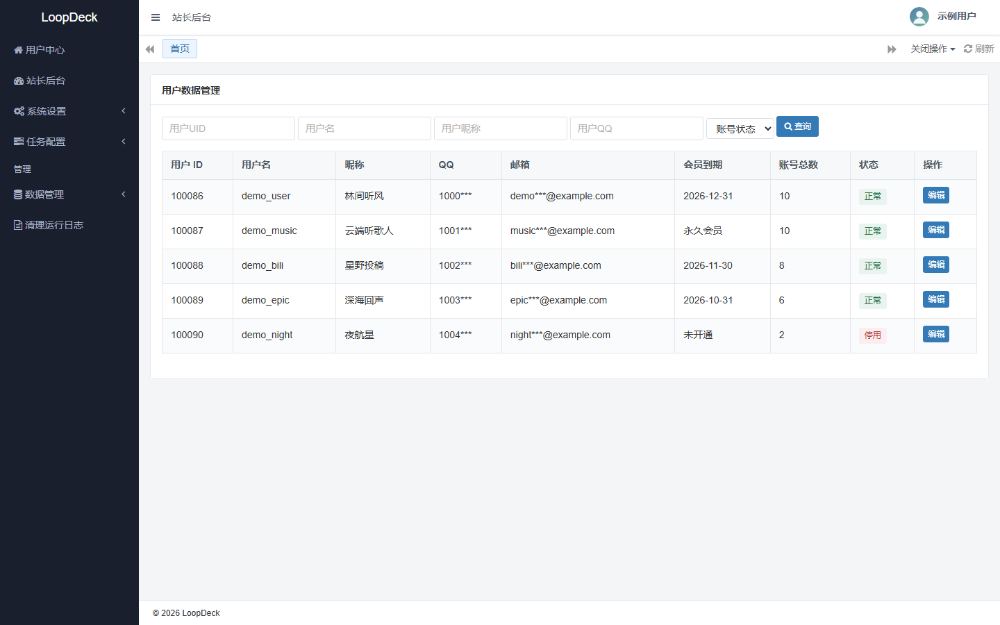

<div align="center">
  <a href="https://github.com/7788dev/loopdeck">
    
  </a>

  <h1>LoopDeck</h1>

  <p><strong>自托管的多平台云任务面板</strong></p>
  <p>网易云音乐 · 哔哩哔哩 · Epic 周免<br>
  统一管理账号、任务、进度与通知。</p>

  <p>
    <a href="https://github.com/7788dev/loopdeck/actions/workflows/docker-image.yml"></a>
    
    
    <a href="https://github.com/7788dev/loopdeck/pkgs/container/loopdeck"></a>
    <a href="LICENSE"></a>
  </p>

  <p>
    <a href="#快速开始">快速开始</a> ·
    <a href="#功能概览">功能</a> ·
    <a href="#界面预览">预览</a> ·
    <a href="#文档">文档</a> ·
    <a href="#版本">版本</a>
  </p>
</div>

LoopDeck 将多个平台的日常任务集中到一个面板，提供账号绑定、自动调度、进度核验和结果通知。采用 PHP 8.2 与 ThinkPHP 8，提供适用于 x86 和 Arm 服务器的 Docker 镜像。

## 功能概览

| 平台 / 模块 | 主要功能 |
| :--- | :--- |
| **网易云音乐** | 每日签到、VIP 成长、每日 300 首听歌、音乐人及合伙人任务；支持历史去重、限时核验与失败原因展示 |
| **哔哩哔哩** | 扫码或短信绑定账号，七项任务独立启停；查看等级经验明细，完成大会员积分签到与福利任务 |
| **Epic 商城** | 每周免费游戏列表与提醒，按个人偏好发送通知 |
| **账号与任务** | 多账号管理、任务计划、进度展示、运行日志与失败重试 |
| **通知中心** | Bark、PushPlus、WxPusher 与 SMTP 邮件；可独立开启每日任务总览 |
| **权益管理** | 通过管理员设置、注册赠送和兑换码分配会员时长及跨平台账号额度 |
| **部署运维** | Docker Compose、内置 MySQL、健康检查、镜像自动更新与持久化存储 |

任务说明、听歌核验机制与高级参数见 [功能与高级说明](docs/FEATURES.md)。

## 快速开始

### Docker 部署

准备一台安装了 Docker Engine 与 **Docker Compose 2.20.0+** 的服务器，在终端执行：

```bash
git clone https://github.com/7788dev/loopdeck.git
cd loopdeck
sh docker/deploy.sh
```

部署脚本会自动生成配置、数据库凭据和调度密钥，拉取镜像并启动服务。

1. 访问 `http://服务器地址:8001`，按安装页提示填写管理员信息。
2. 在控制台绑定平台账号，选择任务并设置运行计划。
3. 按需配置通知渠道，在任务页面查看进度与运行结果。

默认使用内置 MySQL，数据库连接由部署脚本配置。外部 MySQL、域名与反向代理配置见 [部署指南](docs/DEPLOYMENT.md)。

### 已有部署升级

普通应用更新由镜像更新器完成，默认每 6 小时检查一次。可在后台「自动更新状态」点击「立即检查」提前触发检查。

升级时保留原项目目录、`.env`、Compose 项目名和数据卷。涉及部署配置的变更按 [Docker 部署与运维](DOCKER.md) 执行；更新前备份并验证恢复。

<details>
<summary><strong>让 AI Agent 帮你部署</strong></summary>

将下面这段提示词交给 Claude Code、Codex 或其他能执行终端命令的 Agent：

```text
请帮我部署 LoopDeck，项目地址：https://github.com/7788dev/loopdeck。

先阅读 AGENTS.md、docs/DEPLOYMENT.md 和 DOCKER.md，再检查服务器系统、Docker Compose 版本、内存、端口与已有容器。需要 Docker Compose 2.20.0+。默认使用项目自带 MySQL，在项目目录运行 sh docker/deploy.sh，不要手写数据库密码或先手工建库。首次访问完成安装页，只创建管理员账号。保留已有 .env、数据卷和其他服务；不要通过删除数据卷解决问题，也不要在报告中暴露密钥。最后报告访问地址、版本、安装状态，以及日志、重启、备份和更新的方式。
```

</details>

## 界面预览

控制台集中展示平台入口、公告与运行概览。点击图片可查看原图。

<p align="center">
  <a href="docs/screenshots/console.png"></a>
</p>

<details>
<summary><strong>查看账号绑定、任务管理与管理后台</strong></summary>

<br>

<table>
  <tr>
    <td width="50%"><a href="docs/screenshots/netease-qr.png"></a><p align="center"><sub>网易云音乐 · 扫码绑定</sub></p></td>
    <td width="50%"><a href="docs/screenshots/bilibili-qr.png"></a><p align="center"><sub>哔哩哔哩 · 扫码与短信绑定</sub></p></td>
  </tr>
  <tr>
    <td width="50%"><a href="docs/screenshots/netease-manage.png"></a><p align="center"><sub>网易云音乐 · 任务进度与等级</sub></p></td>
    <td width="50%"><a href="docs/screenshots/bilibili-manage.png"></a><p align="center"><sub>哔哩哔哩 · 任务开关与日志</sub></p></td>
  </tr>
  <tr>
    <td width="50%"><a href="docs/screenshots/epic.png"></a><p align="center"><sub>Epic 周免 · 游戏列表与提醒</sub></p></td>
    <td width="50%"><a href="docs/screenshots/admin.png"></a><p align="center"><sub>管理后台 · 运行概览</sub></p></td>
  </tr>
  <tr>
    <td width="50%"><a href="docs/screenshots/login.jpg"></a><p align="center"><sub>登录页面 · 账号访问</sub></p></td>
    <td width="50%"><a href="docs/screenshots/admin-users.png"></a><p align="center"><sub>用户管理 · 会员、配额与账号状态</sub></p></td>
  </tr>
</table>

</details>

截图均使用脱敏示例数据；昵称、账号、邮箱与 QQ 为演示值，二维码无法用于实际登录。

## 文档

| 阅读目的 | 文档 | 内容 |
| :--- | :--- | :--- |
| 首次部署 | [部署指南](docs/DEPLOYMENT.md) | 安装流程、外部 MySQL、升级与备份 |
| 日常运维 | [Docker 部署与运维](DOCKER.md) | 服务管理、环境变量、反向代理与自动更新 |
| 配置任务 | [功能与高级说明](docs/FEATURES.md) | 平台任务、听歌核验、通知与账号权益 |
| 了解变更 | [更新日志](docs/CHANGELOG.md) | 当前版本、修复记录与历史更新 |
| 参与开发 | [仓库贡献指南](AGENTS.md) | 代码结构、测试要求与协作约定 |
| 查阅分析 | [系统分析与修复报告](docs/SYSTEM-ANALYSIS-2026-10-13.md) | 安全、并发与数据库修复记录 |

## 开发与贡献

### 本地运行

需要 PHP 8.2、Composer 与 MySQL。

```bash
composer install
cp config/Db.example.php config/Db.php
# 在 config/Db.php 中填写本地 MySQL 连接信息
php think run
```

### 回归测试

离线测试需要 Node.js 与 PHP `pdo_sqlite` 扩展，数据库回归使用隔离的内存数据库。

```bash
for test_file in tests/*Test.php; do php "$test_file" || exit 1; done
node tests/FrontendInteractionTest.js
```

Windows 可用 `php -d extension=pdo_sqlite` 启用 SQLite；部署脚本测试还需将 `LOOPDECK_TEST_SHELL` 指向 Git for Windows 的 `bin/sh.exe`。具体要求见 [测试指南](AGENTS.md#testing-guidelines)。

### 项目结构

```text
loopdeck/
├── app/       用户端、管理端、任务调度、安装器与共享服务
├── extend/    各平台适配器
├── config/    应用、数据库、视图与中间件配置
├── public/    入口文件与静态资源
├── docker/    部署、镜像与更新器脚本
├── tests/     离线回归、数据库与前端交互测试
└── docs/      部署、功能与版本文档
```

提交问题或改动前，请阅读 [仓库贡献指南](AGENTS.md)。Bug 报告请附版本、部署方式、复现步骤与脱敏日志。

## 版本

当前发布：**v1.2.41** · 2026-11-11

哔哩哔哩新增大会员积分任务与今日等级经验明细，对齐当前会员中心协议。

- 大会员积分作为独立任务，支持签到、福利积分及已开放的权益页 / 装扮商城浏览奖励，一次性奖励按任务状态领取；
- 账号详情展示基础经验、大会员加成与投币目标，区分已确认、待确认和读取失败，不增加原有投币支出；
- 会员协议补齐账号、设备与平台参数，积分到账复查保留提交记录，遇明确风控验证停止自动尝试；
- 清理过期协议说明，保留旧任务的拒绝入口与历史，以及仍有效的漫画、银瓜子兑换任务；
- 74 个 PHP 离线回归与前端交互回归通过；无数据库结构变更，Compose 服务与生产环境变量不变。

完整发布记录见 [更新日志](docs/CHANGELOG.md)。

## 免责声明

本项目仅用于个人学习、技术研究与交流，与网易云音乐、哔哩哔哩、Epic Games 等第三方平台无隶属、合作或授权关系。请遵守所在地法律法规与平台服务条款，禁止批量注册、账号交易、恶意刷量及任何违法或侵权用途。使用者自行承担账号限制、数据丢失和服务中断等风险。完整条款见 [免责声明](DISCLAIMER.md)。

## 许可证

本项目以 [MIT License](LICENSE) 开源，版权归 LoopDeck contributors 所有。第三方平台名称与商标归其各自权利人所有。
